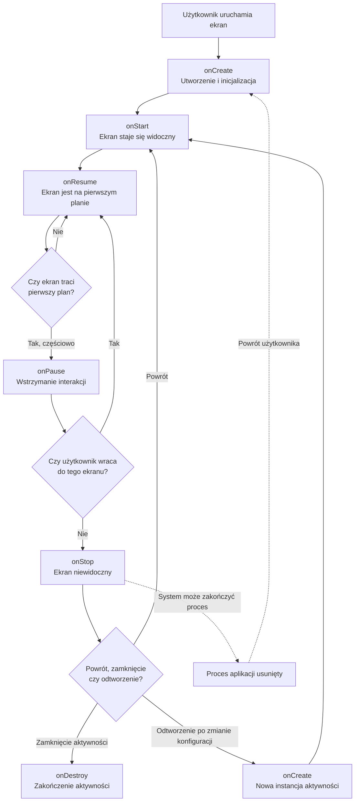

# Cykl życia aplikacji na Androidzie

Android zarządza cyklem życia aplikacji, aby przydzielać zasoby i reagować na działania użytkownika, np. otwarcie innego ekranu, powrót do aplikacji lub zmianę konfiguracji urządzenia. W praktyce najczęściej omawia się cykl życia **aktywności** (`Activity`) — ekranu aplikacji. Aplikacja może składać się z wielu aktywności, a każda z nich ma własny cykl życia.

## Schemat blokowy

## Metody cyklu życia

| Metoda | Kiedy jest wywoływana | Typowe zastosowanie |
| --- | --- | --- |
| `onCreate()` | Przy tworzeniu instancji aktywności | Inicjalizacja, ustawienie widoku, odtworzenie dostępnego stanu |
| `onStart()` | Gdy aktywność staje się widoczna | Przygotowanie zasobów potrzebnych, gdy ekran jest widoczny |
| `onResume()` | Gdy aktywność jest na pierwszym planie i użytkownik może z nią wchodzić w interakcję | Wznowienie animacji, kamery lub nasłuchiwania zdarzeń wymagających aktywnego ekranu |
| `onPause()` | Gdy aktywność traci pierwszy plan, ale może być nadal częściowo widoczna | Szybkie wstrzymanie pracy wymagającej aktywnego pierwszego planu i zapis drobnych zmian |
| `onStop()` | Gdy aktywność przestaje być widoczna | Zatrzymanie pracy potrzebnej wyłącznie na widocznym ekranie i zwolnienie zbędnych zasobów |
| `onDestroy()` | Gdy instancja aktywności jest kończona, np. przez `finish()` lub zmianę konfiguracji | Ostateczne sprzątanie zasobów powiązanych z instancją; nie jest gwarantowane przy zakończeniu procesu przez system |

Typowa kolejność przy uruchomieniu to `onCreate()` → `onStart()` → `onResume()`. Gdy użytkownik opuszcza ekran, zwykle następują `onPause()` → `onStop()`. Powrót do zatrzymanej aktywności prowadzi przez `onRestart()` → `onStart()` → `onResume()`; `onRestart()` nie występuje przy pierwszym uruchomieniu.

## Zapis i odtwarzanie stanu

- `onSaveInstanceState()` pozwala zapisać niewielki, przejściowy stan interfejsu, np. pozycję przewijania. System może później przekazać go w `savedInstanceState` do `onCreate()` albo `onRestoreInstanceState()`.
- Stan potrzebny do odtworzenia działania aplikacji należy przechowywać trwale lub w odpowiednim modelu, np. bazie danych albo `ViewModel`. Nie należy polegać na tym, że `onDestroy()` zostanie wywołane przed usunięciem procesu.
- Zmiana konfiguracji, np. obrót ekranu, może spowodować zniszczenie i utworzenie nowej instancji aktywności. Nie oznacza to automatycznie zakończenia procesu aplikacji.
- Gdy aplikacja przechodzi w tło, Android może później zakończyć jej proces, aby odzyskać pamięć. Przy następnym otwarciu aktywności proces i ekran mogą zostać utworzone ponownie.

## Ważne wskazówki

1. Nie wykonuj długich operacji w metodach cyklu życia; używaj odpowiednich korутин, zadań lub komponentów działających w tle.
2. Zatrzymuj zasoby wtedy, gdy przestają być potrzebne, i wznawiaj je w odpowiednich callbackach. Unikaj uruchamiania tego samego nasłuchiwania wielokrotnie.
3. Traktuj aktywność jako ekran, a nie cały proces aplikacji. Jej `onDestroy()` nie jest niezawodnym sygnałem, że aplikacja została zamknięta.
4. Zapisuj tylko małe dane interfejsu w stanie instancji; ważne dane aplikacji przechowuj niezależnie od cyklu życia aktywności.
